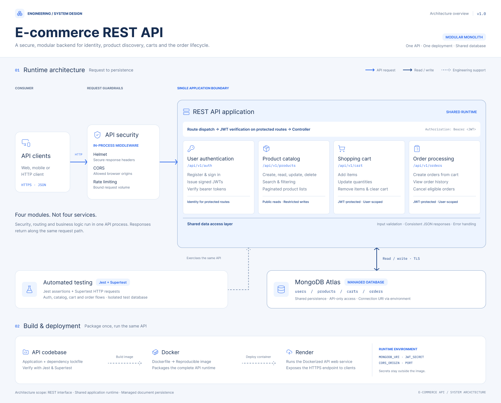

# 🛒 E-Commerce REST API

A secure and scalable RESTful API for an online retail platform, built using Node.js, Express.js, MongoDB, and JWT authentication.

This project is being developed as part of an internship at **Ultimez Pvt. Ltd.** It focuses on backend development, authentication, product management, shopping cart operations, order processing, API security, automated testing, and deployment.

## 🚀 Live Deployment

**Live API:** https://ecommerce-rest-api-0tk9.onrender.com

**GitHub Repository:** https://github.com/rdrakshh-lgtm/ecommerce-rest-api

### Health Check

Verify that the deployed API is responding:

https://ecommerce-rest-api-0tk9.onrender.com/

## ✨ Features

### 1. Authentication and User Management
- User registration and login
- Password hashing using bcryptjs
- JWT-based authentication
- Protected routes
- Role-based authorization
- User profile management
- Profile updates and password changes

### 2. Product Management
- Create, retrieve, update, and delete products
- Product search and filtering
- Sorting and pagination
- Inventory and stock management
- Input validation

### 3. Shopping Cart
- Add products to the cart
- View cart items
- Update product quantities
- Remove individual items
- Clear the cart
- Validate cart items and quantities

### 4. Order Processing
- Create orders
- View order history
- Cancel eligible orders
- Validate order data
- Manage order-related operations

### 5. Security
- JWT authentication
- Role-based access control
- Helmet security middleware
- CORS configuration
- API rate limiting
- Environment variable configuration
- Request logging with Morgan

### 6. Testing
- Automated API tests using Jest and Supertest
- Authentication and authorization testing
- Product validation tests
- Shopping cart and order validation tests
- Rate-limiting tests

### 7. Containerization and Deployment
- Docker containerization
- Docker Compose configuration
- MongoDB Atlas integration
- Deployment on Render

## 🧰 Technology Stack

| Category | Technologies |
|---|---|
| Runtime | Node.js |
| Backend Framework | Express.js |
| Database | MongoDB Atlas |
| ODM | Mongoose |
| Authentication | JSON Web Token (JWT) |
| Password Security | bcryptjs |
| Security Middleware | Helmet, CORS, express-rate-limit |
| Logging | Morgan |
| Testing | Jest, Supertest |
| API Testing | Postman |
| Containerization | Docker, Docker Compose |
| Deployment | Render |
| Version Control | Git, GitHub |

## 🏗️ System Architecture

The application follows a modular backend architecture.

```text
                  API CLIENT
                      |
                      v
               Express.js Server
                      |
           Security and Middleware
                      |
          +-----------+-----------+
          |           |           |
          v           v           v
     Authentication Products     Users
          |           |           |
          +-----------+-----------+
                      |
             Shopping Cart
                      |
                      v
               Order Processing
                      |
                      v
                Mongoose ODM
                      |
                      v
                MongoDB Atlas


       Testing: Jest + Supertest
       Containerization: Docker
       Deployment: Render
```

## 🖼️ Architecture Design

The Phase 2 architecture diagram illustrates the API components, authentication flow, product management, shopping cart, order processing, database, testing, and deployment.



## 📁 Project Structure

```text
ecommerce-rest-api/
│
├── docs/
│   └── phase-2-architecture.png
│
├── src/
│   ├── config/
│   ├── controllers/
│   ├── middleware/
│   ├── models/
│   ├── routes/
│   ├── services/
│   ├── utils/
│   └── validators/
│
├── tests/
├── .postman/
├── postman/
│   └── globals/
│
├── .env.example
├── .gitignore
├── .dockerignore
├── Dockerfile
├── docker-compose.yml
├── jest.config.js
├── package.json
├── package-lock.json
├── server.js
└── README.md
```

## ⚙️ Getting Started

### Prerequisites

Install the following tools:

- Node.js and npm
- Git
- MongoDB Atlas account or a MongoDB instance
- Postman (optional, for API testing)
- Docker Desktop (optional, for containerized execution)

### 1. Clone the repository

```bash
git clone https://github.com/rdrakshh-lgtm/ecommerce-rest-api.git
```

### 2. Navigate to the project

```bash
cd ecommerce-rest-api
```

### 3. Install dependencies

```bash
npm install
```

### 4. Configure environment variables

Create a `.env` file in the project root.

Use `.env.example` as a reference:

```env
PORT=5000
MONGO_URI=your_mongodb_connection_string
JWT_SECRET=your_secure_jwt_secret
NODE_ENV=development
```

Replace the example values with your own configuration.

**Security note:** Never commit your `.env` file, database credentials, or JWT secrets to GitHub.

### 5. Start the development server

```bash
npm run dev
```

If the development script is unavailable, check the scripts in `package.json`.

The default local port is `5000`, unless overridden by your environment configuration.

## 🧪 Running Automated Tests

Run the complete test suite:

```bash
npm test
```

The project has previously passed **46 automated tests across 7 test suites**.

Test coverage includes product validation, shopping cart and order validation, and rate limiting, alongside other API tests.

Run the latest test suite before relying on these results for a new release.

## 🐳 Running with Docker

Make sure Docker Desktop is running.

Build and start the application using Docker Compose:

```bash
docker compose up --build
```

To stop the containers:

```bash
docker compose down
```

Ensure the required environment variables and MongoDB connection are configured for the containerized application.

## 🔐 Authentication

Protected endpoints require a valid JWT access token.

Include the token in the HTTP request header:

```http
Authorization: Bearer <your-jwt-token>
```

Obtain a token by registering and logging in through the authentication endpoints.

Use Postman to test authenticated requests and role-based access restrictions.

## 📮 API Testing with Postman

The repository includes Postman-related files for API testing.

Typical testing scenarios include:

- User registration and login
- Access to protected routes
- Product listing and management
- Search, filtering, and pagination
- Shopping cart operations
- Order creation and cancellation
- Invalid input handling
- Authorization and security checks
- HTTP status code validation

For the deployed API, use this base URL:

```text
https://ecommerce-rest-api-0tk9.onrender.com
```

Refer to the application's routes and Postman collection for the exact endpoint paths and request bodies.

## 📈 Project Outcomes

- Developed a RESTful backend for an online retail platform.
- Implemented authentication and role-based access control.
- Built product, shopping cart, and order management functionality.
- Added API security middleware and input validation.
- Created automated API tests using Jest and Supertest.
- Containerized the application with Docker and Docker Compose.
- Deployed the API using Render.
- Maintained the source code and project documentation on GitHub.

## 🔮 Future Improvements

Potential future enhancements include:

- API documentation with Swagger/OpenAPI
- Expanded automated test coverage
- Continuous integration and deployment
- Performance monitoring and optimization
- Additional inventory and order workflow improvements

## 👨‍💻 Author

**Rd Rakshh**

Software Engineering Student | Backend Development Intern

**GitHub:** https://github.com/rdrakshh-lgtm

**Project:** E-Commerce REST API

**Organization:** Ultimez Pvt. Ltd.

---

*Built as part of a hands-on backend development internship project.*